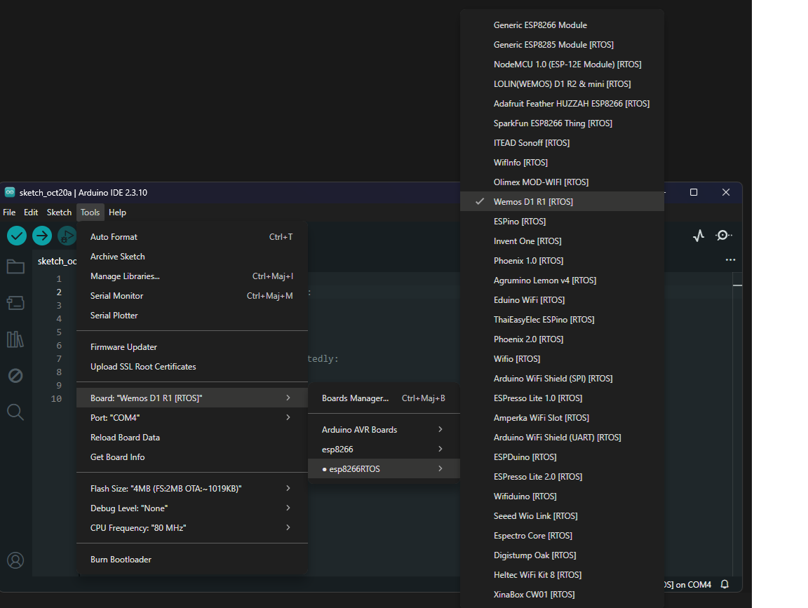
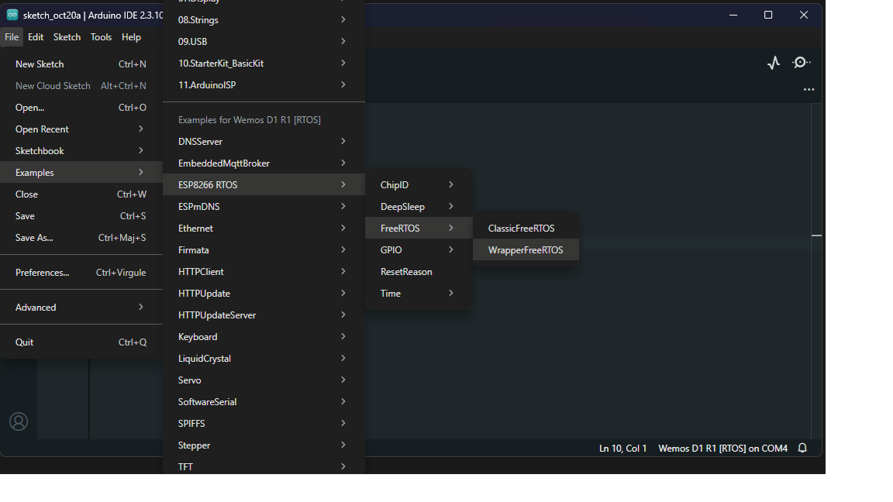

* **No more `msys32` required:** This script will automatically download and extract the native Windows toolchain (GCC, CMake, Ninja, Python, etc.) directly from the attached releases, without needing to install `msys32` in the C: root.
* It will also install the necessary Python requirements.

Select esp8266 boards RTOS:

* **Now you are ready to write and install sketches using Arduino IDE 2.3.10 or VSCode!**

### Warning
> [!CAUTION]
> 

Since the compilation process now runs natively on Windows without `msys32`, there are a few things to keep in mind:
* **Verify process:** When you verify a sketch, the compilation output will now appear directly in the Arduino IDE terminal (or the standard Windows console), making error tracking much easier.
* **Flash process:** The flashing process runs natively, and the logs are displayed directly in the Arduino IDE terminal.

# Examples

* **Basic blink example**
~~~c++

/*
* Based on arduino esp32 arduino core FreeRTOS.ino example.
*/

#ifndef LED_BUILTIN
#define LED_BUILTIN 2
#endif

// define two tasks for Blink
void TaskBlink( void *pvParameters );

// the setup function runs once when you press reset or power the board
void setup() {
  
  // initialize serial communication at 115200 bits per second:
  Serial.begin(115200);
  
  // Now set up tasks to run independently.
  xTaskCreatePinnedToCore(
    TaskBlink
    ,  "TaskBlink"   // A name just for humans
    ,  1024  // This stack size can be checked & adjusted by reading the Stack Highwater
    ,  NULL
    ,  2  // Priority, with 3 (configMAX_PRIORITIES - 1) being the highest, and 0 being the lowest.
    ,  NULL 
    ,  ARDUINO_RUNNING_CORE); // in esp8266 allways is 0

  // Now the task scheduler, which takes over control of scheduling individual tasks, is automatically started.
}

void loop()
{
  // do nothing.
}

void TaskBlink(void *pvParameters) 
{
  pinMode(LED_BUILTIN, OUTPUT);

  while (true) // A Task shall never return or exit.
  {
    digitalWrite(LED_BUILTIN, HIGH);   // turn the LED on (HIGH is the voltage level)
    vTaskDelay(pdMS_TO_TICKS(500)); 
    digitalWrite(LED_BUILTIN, LOW);    // turn the LED off by making the voltage LOW
    vTaskDelay(pdMS_TO_TICKS(500)); 
  }
}

~~~

* More examples in 
  
~~~
/packages/esp8266RTOS/hardware/esp8266RTOS/x.x.x/libraries/ 
~~~

# Limitations

> [!CAUTION]
> 
* The compatibility between libraries of esp8266ArduinoCore based on NONOSDK, and this core, esp8266RTOSArduCore based on FreeRTOS is limited, in general you can use the same esp8266ArduinoCore libraries that have compatibily with esp32 arduino core. 

* It is assumed that external third-party-libaries are in ~/Arduino/libraries.

* ~~There is not supported to recursive includes to external libraries, all libraries you need must be includes in your .ino scketch~~

* libraries or utilities for specific hardware of esp32, like bluetooth or hall sensor is not supported in this core.

* ~~set compile option is not supported yet~~.

* ~~for now only support generic board esp8266 pins map, that is only for the way to name gpios pin in scketchs. You can install scketchs in others boards using generic name of gipo pins.~~  

* ~~It is not supported changes deboug level info from IDE yet, you need to changes it manually in esp32-hal-log.h~~

# To Do List

- [x] Implement way to resolve recursive includes.
- [x] Rewrite paltafrom.txt to give support to compile options. 
- [x] Add esp8266 boards configurations in boards.txt
- [x] Add pins map support for more models of esp8266 boards.
- [x] Changes bash scripts to python scripts to support more OS.
- [x] **Remove msys32 dependency for Windows compilation.**
- [x] **Add compatibility with Arduino IDE 2.3.10.**

# List of core files to adapt test and fix

- [ ]  core/esp8266/esp32-hal-adc.c
- [ ]  core/esp8266/esp32-hal-i2c.c
- [ ]  core/esp8266/esp32-hal-i2c-slave.c
- [ ]  core/esp8266/esp32-hal-psram.c
- [ ]  core/esp8266/esp32-hal-sigmadelta.c
- [ ]  core/esp8266/esp32-hal-spi.c
- [x]  core/esp8266/esp32-hal-time.c
- [ ]  core/esp8266/esp32-hal-timer.c
- [ ]  core/esp8266/Tone.cpp
- [ ]  core/esp8266/esp32-hal-tinyusb.c ?
- [x]  core/esp8266/base64.cpp
- [x]  core/esp8266/cbuf.cpp  
- [x]  core/esp8266/esp32-hal-time.c
- [x]  core/esp8266/esp32-hal-cpu.c
- [x]  core/esp8266/esp32-hal-gpio.c
- [x]  core/esp8266/esp32-hal-misc.c
- [x]  core/esp8266/esp32-hal-uart.c
- [x]  core/esp8266/Esp.cpp
- [x]  core/esp8266/FunctionalInterrupt.cpp
- [x]  core/esp8266/HardwareSerial.cpp
- [x]  core/esp8266/IPAddress.cpp
- [x]  core/esp8266/IPv6Address.cpp
- [x]  core/esp8266/libb64/cdecode.c
- [x]  core/esp8266/libb64/cencode.c
- [x]  core/esp8266/main.cpp
- [x]  core/esp8266/MD5Builder.cpp
- [x]  core/esp8266/Print.cpp
- [x]  core/esp8266/stdlib_noniso.c
- [x]  core/esp8266/Stream.cpp
- [x]  core/esp8266/StreamString.cpp
- [x]  core/esp8266/wiring_pulse.cpp
- [x]  core/esp8266/wiring_shift.cpp
- [x]  core/esp8266/WMath.cpp
- [x]  core/esp8266/WString.cpp

# List of basic libraries to Test and fix

- [x] WiFi
- [x] EmbeddedMqttBroker
- [x] WrapperFreeRTOS
- [x] WebServer
- [x] WiFiClientSecure
- [x] WiFiProv
- [x] HTTPClient
- [x] HttpUpdate
- [x] HttpUPdateServer
- [x] DNSServer
- [x] ESPmDNS
- [ ] AyncUDP?
- [x] Update
- [x] ArduinoOta
- [ ] EEPROM
- [x] ESP[32|8266] examples
- [ ] FFat
- [x] FS
- [ ] NetBios
- [ ] Preferences?
- [ ] SD
- [ ] SDMMC?
- [ ] SPI
- [x] SPIFFS
- [ ] Ticker
- [ ] Wire

# License

* esp8266_RTOS_SDK is under Apache-2.0 license.

# Links of interest

* [Official repo of esp8266 RTOS SDK](https://github.com/espressif/ESP8266_RTOS_SDK)
* [Esp8266 rtos sdk docu](https://docs.espressif.com/projects/esp8266-rtos-sdk/en/latest/)
* [esp32 arduino core repo](https://github.com/espressif/arduino-esp32)
* [Esp8266 arduino comunity](https://www.esp8266.com/viewforum.php?f=25)